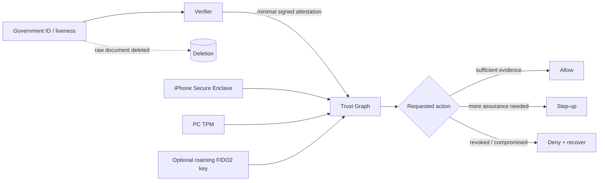

# Daybreak Trust Graph

**A public, unofficial proposal for high-assurance trusted access with less repeated identity proofing and less user friction.**

> This repository is independent research. It is not an OpenAI product, policy, or security specification.

## One-line idea

**Delete the raw ID document, keep a privacy-preserving proof that verification happened, bind trust to hardware already present on the user's devices, and require extra proof only when the action actually warrants it.**

The goal is not weaker authentication. The goal is to stop paying for the same assurance twice.

## Why this exists

High-risk systems need stronger access controls. But adding a new mandatory object or repeating identity verification every time the policy changes can create three avoidable costs:

1. **Identity cost** — the user proves the same fact again.
2. **Privacy cost** — sensitive source documents are re-collected or re-processed.
3. **Hardware cost** — an already-verified user may need to buy and carry another authenticator even when a platform already has a suitable hardware root of trust.

The design question is therefore:

> Can a system preserve or improve security while making the steady-state authentication work approach zero?

This proposal says yes.

## Design principles

### 1. Throw away the document, not the fact that verification succeeded

After an identity provider verifies a user, the relying service should retain a **minimal signed identity attestation**, not the raw driver's-license/passport image.

Example claims:

```text
subject: opaque-user-id
verified_at: 2026-09-12T03:14:15Z
verification_class: government-id+liveness
issuer: approved-verifier
assurance_level: high
expires_at: 2027-09-12T03:14:15Z
revocation_handle: ...
```

The attestation can be purpose-bound, short-lived, revocable, and re-issued without exposing the original document.

### 2. Reuse hardware the user already owns

A high-assurance account can bind to **non-exportable device keys** backed by Secure Enclave, TPM, StrongBox, or equivalent hardware where available.

A roaming FIDO2 security key remains valuable — especially for recovery, cross-device use, and users who explicitly want a separate trust anchor — but it should not automatically become a universal hardware tax.

### 3. Ask for more proof only when risk rises

Authentication is a policy decision over evidence, not a single binary checkbox.

```text
identity attestation
      +
known hardware-backed device
      +
session continuity
      +
recent user presence
      +
action risk
      ↓
minimum sufficient proof
```

Low-risk, continuous use should normally require no additional ceremony. New devices, recovery, unusual behavior, or unusually sensitive actions should trigger step-up authentication.

### 4. Recovery must not have a single point of failure

Losing one physical token should not permanently turn a verified person into an unverified person.

A recovery policy can combine independent evidence such as:

- another previously bound hardware-backed device;
- a recovery code;
- a roaming FIDO2 key;
- a fresh identity attestation;
- delayed/manual review for the highest-risk cases.

### 5. Make the policy inspectable

The system should be able to answer:

> Why was more authentication required this time?

without revealing sensitive anti-abuse signals.

Users should see a coarse explanation such as **new device**, **recovery event**, **high-risk action**, or **identity attestation expired**.

## Reference flow



## The steady-state target

```text
one identity proof
→ raw source document deleted
→ reusable, revocable attestation
→ bind existing trusted devices
→ normal use: ~0 extra authentication work
→ risk change: minimum necessary step-up
```

This is the "zero-work" objective: **remove repeated work, not security controls**.

## Repository map

- [`docs/architecture.md`](docs/architecture.md) — components and trust boundaries.
- [`docs/threat-model.md`](docs/threat-model.md) — attacker model and failure cases.
- [`docs/migration.md`](docs/migration.md) — how an existing high-assurance program could migrate without locking out verified users.
- [`docs/note-to-openai.md`](docs/note-to-openai.md) — concise rationale addressed to reviewers at OpenAI.
- [`src/trust_graph.py`](src/trust_graph.py) — tiny policy-engine prototype illustrating "minimum sufficient proof".
- [`tests/test_trust_graph.py`](tests/test_trust_graph.py) — executable examples.

## Non-goals

This repository does **not** attempt to reverse engineer Daybreak, bypass access controls, weaken abuse prevention, or claim knowledge of OpenAI's internal authentication architecture.

It proposes a general architecture for privacy-preserving, risk-adaptive trusted access.

## Feedback

Security engineers, identity engineers, privacy engineers, and abuse-prevention teams: adversarial review is welcome. In particular, please challenge the recovery model, device-binding semantics, attestation lifetime, and migration path.

## License

MIT. See [`LICENSE`](LICENSE).
